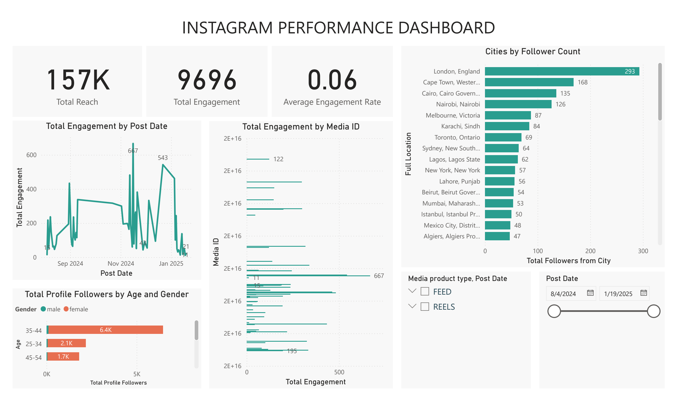

# Instagram Performance Analytics Dashboard (Power BI)

**Author:** Vinay Kumar Chinthamalla ([Microsoft Certified: Power BI Data Analyst Associate PL-300](https://learn.microsoft.com/en-us/users/vinaykumar-2793/credentials/663fd6b319aef6d9?ref=https%3A%2F%2Fwww.linkedin.com%2F))  
**Files Included:**
- [`POWER BI Dashboard.pbix`](./POWER%20BI%20Dashboard.pbix) — Interactive Power BI Desktop report
- [`Instagram Performance Dashboard.pdf`](./Instagram%20Performance%20Dashboard.pdf) — Full PDF export
- [`Instagram_Analytics.xlsx`](./Instagram_Analytics.xlsx) — Underlying dataset

---

## Dashboard Preview

---

## Project Overview
Built an interactive **Power BI** executive dashboard to analyze Instagram post performance, audience demographics, and user engagement trends across a 6-month period for the real-world dataset from **"My Thriving Child."**

### Key Metrics & Insights Surfaced
- **Headline KPIs:** Tracked **157K Total Reach**, **9,696 Total Engagements**, and a **6.0% Average Engagement Rate** across a 6-month window.
- **Custom DAX Calculations:** Engineered dynamic DAX measures for engagement rate, reach-to-impression ratios, and rolling temporal comparisons by post format and publication date.
- **Interactive Visual Storytelling:**
  - Time-series engagement trend lines and post-frequency breakdowns.
  - Content format comparison (**Feed Posts vs. Reels vs. Carousels**).
  - Audience demographic splits by **Age Group (`18–24`, `25–34`, `35–44`, `45+`)** and **Gender**.
  - Geographic follower distribution across top cities.
- **Strategic Business Impact:** Demonstrated that **Feed posts outperformed Reels** in sustained engagement and identified the **35–44 female demographic** as the highest-converting audience segment.

---

## Technologies Used
- **BI & Analytics:** `Microsoft Power BI Desktop`, `DAX (Data Analysis Expressions)`, `Power Query (M)`
- **Skills Applied:** `Data Modeling`, `Data Cleaning`, `KPI Design`, `Interactive Slicers`, `Visual Storytelling`
